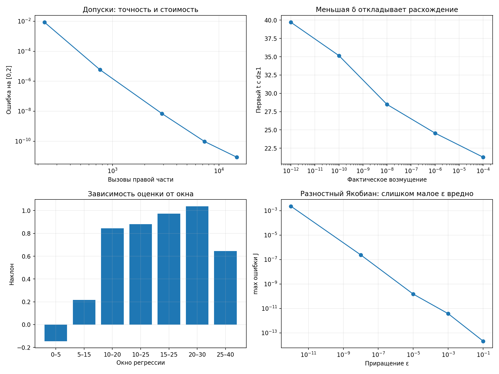

# Экспериментальная проверка констант

Таблицы сгенерированы из реальных расчётов `parameter_study.py`; источники — `results/constants_study/*.csv` и `study.json`. Пустые значения не заменялись искусственными числами. Пояснения выбора и ограничения: [constants-explained.md](constants-explained.md).

Версии: {'python': '3.12.14', 'numpy': '2.3.5', 'scipy': '1.17.0'}

## Параметры модели

Изменяется по одному параметру при прочих классических. std_x вычислена на конечном хвосте, это не классификатор хаоса. max_real_eigen_Cplus относится только к C+, не ко всей траектории. «—» означает отсутствие C+ при rho≤1.

| parameter | value | max_state_norm | tail_std_x | equilibria_count | max_real_eigen_Cplus |
| --- | --- | --- | --- | --- | --- |
| sigma | 5 | 50.2946766 | 0.881405059 | 3 | -0.134579773 |
| sigma | 10 | 52.1893018 | 7.80818685 | 3 | 0.093955624 |
| sigma | 20 | 53.496378 | 1.29097757 | 3 | -0.110171688 |
| rho | 0.5 | 1.73205081 | 0.00867465273 | 1 | — |
| rho | 20 | 36.6393316 | 0.569728467 | 3 | -0.154791771 |
| rho | 28 | 52.1893018 | 7.80818685 | 3 | 0.093955624 |
| rho | 40 | 75.6413463 | 9.72078695 | 3 | 0.377614068 |
| beta | 1.33333333 | 52.934776 | 5.74819569 | 3 | 0.222283108 |
| beta | 2.66666667 | 52.1893018 | 7.80818685 | 3 | 0.093955624 |
| beta | 5.33333333 | 51.7266372 | 0.362240886 | 3 | -0.490733048 |

## Начальные состояния

Нулевое состояние — точное равновесие, начальная скорость равна нулю. Иные точки задают другие задачи Коши, а не разную точность одного метода.

| initial | initial_speed | max_norm | final_norm |
| --- | --- | --- | --- |
| [0, 0, 0] | 0 | 0 | 0 |
| [0.5, 0.5, 0.5] | 13.2942134 | 52.5769661 | 33.5184896 |
| [1, 1, 1] | 26.053364 | 52.1893018 | 17.766799 |
| [2, 2, 2] | 50.0177746 | 51.5192673 | 18.3754388 |

## Длина короткого интервала

Максимум ошибки возникает рано: одинаковые значения на нескольких интервалах — реальный результат, а не ошибка копирования. Порядок по трём малым h.

| end | order_last_three | error_h001 |
| --- | --- | --- |
| 0.5 | 4.01052159 | 0.000798239989 |
| 1 | 4.01052159 | 0.000798239989 |
| 2 | 4.01052159 | 0.000798239989 |
| 4 | 4.01052159 | 0.000798239989 |
| 8 | 4.14162362 | 0.000957336833 |

## Полный горизонт

Ошибка — расхождение с численным эталоном, после потери фазы нельзя трактовать её как точность относительно точного решения. Увеличение горизонта увеличивает стоимость, но также может быть полезно для других задач.

| end | max_rk4_error | distance_at_end | n_steps | nfev |
| --- | --- | --- | --- | --- |
| 0.5 | 0.000798239989 | 6.66561809e-08 | 50 | 200 |
| 1 | 0.000798239989 | 1.11603584e-08 | 100 | 400 |
| 2 | 0.000798239989 | 1.19626693e-08 | 200 | 800 |
| 4 | 0.000798239989 | 1.75760278e-08 | 400 | 1600 |
| 8 | 0.000957336833 | 2.04943371e-08 | 800 | 3200 |
| 16 | 0.0821117143 | 5.50706667e-07 | 1600 | 6400 |
| 20 | 5.57125234 | 1.06823722e-05 | 2000 | 8000 |
| 40 | 50.2803717 | 20.516037 | 4000 | 16000 |
| 80 | 52.6448965 | 24.0864588 | 8000 | 32000 |

## Допуски RK45

Общая сетка на [0,2], контроль DOP853 3e−14/1e−15. Одновременно изменяются rtol и atol с указанными значениями; это сравнение пар, не независимая оценка эффекта каждого допуска. Время — медиана.

| rtol | atol | max_error | nfev | n_steps | seconds_median |
| --- | --- | --- | --- | --- | --- |
| 0.0001 | 1e-06 | 0.0085428209 | 230 | 33 | 0.001283373 |
| 1e-07 | 1e-09 | 5.78524463e-06 | 764 | 123 | 0.003991858 |
| 1e-10 | 1e-12 | 6.84985202e-09 | 2918 | 484 | 0.015390454 |
| 1e-12 | 1e-14 | 9.58439852e-11 | 7298 | 1214 | 0.035569202 |
| 3e-14 | 1e-15 | 8.53283376e-12 | 14678 | 2445 | 0.067052387 |

## Величина возмущения

actual_delta — фактически представленная разность, не запрошенное число. Пустое first_above_one означает, что порог не достигнут до T=40; пустой наклон означает недостаток ненулевых данных.

| requested_delta | actual_delta | first_above_one | slope | r_squared | d_min | d_max |
| --- | --- | --- | --- | --- | --- | --- |
| 0.0001 | 0.0001 | 21.27 | 0.866631981 | 0.94352601 | 7.37283023e-05 | 24.4020582 |
| 1e-06 | 1e-06 | 24.56 | 0.880454009 | 0.939632545 | 7.37286939e-07 | 1.55323596 |
| 1e-08 | 9.99999994e-09 | 28.48 | 0.8809637 | 0.939506357 | 7.37259607e-09 | 0.0160734083 |
| 1e-10 | 1.00000008e-10 | 35.15 | 0.880914443 | 0.939480697 | 7.36855934e-11 | 0.000160739308 |
| 1e-12 | 1.0000889e-12 | 39.71 | 0.856230966 | 0.933580148 | 8.19355544e-13 | 1.25431508e-06 |
| 1e-14 | 9.99200722e-15 | — | 0.763376043 | 0.913843214 | 3.68460258e-14 | 1.93013392e-08 |
| 1e-16 | 0 | — | — | — | 0 | 0 |

## Окно наклона ln d

Один и тот же расчёт RK4 и возмущение 1e−8, разные окна. Данные позволяют увидеть зависимость вывода от окна; это не спектр Ляпунова.

| start | end | slope | r_squared | d_min | d_max |
| --- | --- | --- | --- | --- | --- |
| 0 | 5 | -0.144761201 | 0.1131129 | 9.28572233e-09 | 2.01073739e-07 |
| 5 | 15 | 0.216251114 | 0.319573967 | 7.37259607e-09 | 1.3554405e-06 |
| 10 | 20 | 0.843446533 | 0.864531658 | 7.37259607e-09 | 8.77135738e-05 |
| 10 | 25 | 0.8809637 | 0.939506357 | 7.37259607e-09 | 0.0160734083 |
| 15 | 25 | 0.973044956 | 0.902925781 | 1.32074168e-07 | 0.0160734083 |
| 20 | 30 | 1.0384769 | 0.910701187 | 9.38417422e-06 | 1.6136125 |
| 25 | 40 | 0.645007864 | 0.850032484 | 0.00219710623 | 42.7500572 |

## Удаление начала на рисунках

Доля и дисперсия приведены только как характеристики оставшегося конечного массива; граница 5 не сертифицирует стационарность.

| discard | retained_fraction | retained_points | std_x |
| --- | --- | --- | --- |
| 0 | 1 | 4001 | 7.66081525 |
| 2 | 0.950012497 | 3801 | 7.64189327 |
| 5 | 0.875031242 | 3501 | 7.75023152 |
| 10 | 0.750062484 | 3001 | 7.87413855 |

## Условный порог расстояния

Порог меняет только диагностический момент, а не динамику или определение хаоса.

| threshold | first_crossing |
| --- | --- |
| 0.1 | 28.23 |
| 1 | 28.48 |
| 10 | 33.46 |

## Сколько последних точек включить в наклон

Все успешные точки исходной серии при соответствующем количестве. Для Эйлера доступно только четыре, поскольку h=.04 не дал конечного решения.

| method | point_count | h_max | h_min | order |
| --- | --- | --- | --- | --- |
| euler | 2 | 0.005 | 0.0025 | 1.32196708 |
| euler | 3 | 0.01 | 0.0025 | 1.58007035 |
| euler | 4 | 0.02 | 0.0025 | 1.38641942 |
| rk4 | 2 | 0.005 | 0.0025 | 4.0093727 |
| rk4 | 3 | 0.01 | 0.0025 | 4.01052159 |
| rk4 | 4 | 0.02 | 0.0025 | 4.01184434 |
| rk4 | 5 | 0.04 | 0.0025 | 3.99425021 |

## Повторения измерения времени

Отдельные серии по 1,3,7 запусков, реальное машинное время. Не оценка статистической сходимости медианы и не гарантия, что 7 обязательно даст лучший результат на другой машине.

| repeats | median_seconds | min_seconds | max_seconds |
| --- | --- | --- | --- |
| 1 | 0.0493045 | 0.0493045 | 0.0493045 |
| 3 | 0.050368465 | 0.049592729 | 0.050949051 |
| 7 | 0.05025074 | 0.048878455 | 0.051680019 |

## Приращение для численного Якобиана

Центральная разность по каждой координате в точке [2.3,−1.4,8.1]. Полиномиальная структура Лоренца устраняет здесь ошибку усечения; при уменьшении eps видна ошибка округления.

| eps | max_entry_error |
| --- | --- |
| 0.1 | 2.13162821e-14 |
| 0.001 | 3.74456022e-12 |
| 1e-05 | 1.49405821e-10 |
| 1e-08 | 2.38410394e-07 |
| 1e-12 | 0.00230202864 |

## Порог нулевых вещественных частей

inconclusive означает, что выбранный порог не позволяет применить критерий устойчивости. Это не вывод об устойчивости. Большой порог .1 скрывает Reλ≈.094.

| threshold | equilibrium | classification |
| --- | --- | --- |
| 1e-12 | O | unstable |
| 1e-12 | C+ | unstable |
| 1e-12 | C- | unstable |
| 1e-10 | O | unstable |
| 1e-10 | C+ | unstable |
| 1e-10 | C- | unstable |
| 1e-06 | O | unstable |
| 1e-06 | C+ | unstable |
| 1e-06 | C- | unstable |
| 0.1 | O | unstable |
| 0.1 | C+ | inconclusive |
| 0.1 | C- | inconclusive |

## Порог проверки делимости интервала

accepted — результат одной проверки isclose, а не изменение траектории. near_noninteger специально показывает принятие очень малого несовпадения.

| rtol | atol | case | length_disagreement | accepted |
| --- | --- | --- | --- | --- |
| 1e-15 | 0 | binary_roundoff | 5.55111512e-17 | True |
| 1e-15 | 0 | near_noninteger | 1.0000889e-12 | False |
| 1e-15 | 0 | noninteger | 1e-07 | False |
| 1e-11 | 1e-13 | binary_roundoff | 5.55111512e-17 | True |
| 1e-11 | 1e-13 | near_noninteger | 1.0000889e-12 | True |
| 1e-11 | 1e-13 | noninteger | 1e-07 | False |
| 1e-06 | 1e-08 | binary_roundoff | 5.55111512e-17 | True |
| 1e-06 | 1e-08 | near_noninteger | 1.0000889e-12 | True |
| 1e-06 | 1e-08 | noninteger | 1e-07 | True |

## Пороги тестов

Измеренная ошибка, установленный порог и их отношение. Отношение >1 оставляет запас; само по себе оно не доказывает, что порог лучший.

| test | measured_error | threshold | threshold_over_error |
| --- | --- | --- | --- |
| rk4_exp | 2.24641195e-10 | 3e-10 | 1.33546298 |
| rk4_nonautonomous | 2.33009168e-11 | 1e-08 | 429.167664 |
| rk4_lorenz | 7.83455379e-08 | 2e-06 | 25.5279375 |

## Разрешение PNG

Настоящие изображения сохранены рядом с таблицей. save_seconds не измеряет качество и зависит от машины. Численная траектория одинакова.

| dpi | width_px | height_px | bytes | save_seconds |
| --- | --- | --- | --- | --- |
| 90 | 576 | 432 | 48587 | 0.030567981 |
| 170 | 1088 | 816 | 105460 | 0.043014917 |
| 300 | 1920 | 1440 | 211455 | 0.089100691 |

## Кадры и частота GIF

Расчёт временной разметки кадров, а не рендер девяти новых GIF. duration=frames/fps — номинальная длительность; Pillow может квантовать длительности до сотых секунды. Строка каждого кадра включает все накопленные точки интегратора.

| frames | fps | duration_seconds | max_simulation_time_gap | all_integrator_points_still_in_line |
| --- | --- | --- | --- | --- |
| 80 | 10 | 8 | 0.51 | True |
| 80 | 20 | 4 | 0.51 | True |
| 80 | 40 | 2 | 0.51 | True |
| 160 | 10 | 16 | 0.26 | True |
| 160 | 20 | 8 | 0.26 | True |
| 160 | 40 | 4 | 0.26 | True |
| 320 | 10 | 32 | 0.13 | True |
| 320 | 20 | 16 | 0.13 | True |
| 320 | 40 | 8 | 0.13 | True |

## Шаг основного RK4: исходная серия

Эти результаты взяты из основного summary.json, а не пересчитаны с изменёнными параметрами. Вычислений на коротком интервале четыре на шаг; сравнение количества вызовов точное, без шумов таймера.

| h | Максимальная ошибка [0,2] | Вызовы f на [0,2] | Вызовы f на [0,40] |
| --- | --- | --- | --- |
| 0.04 | 0.195631272 | 200 | 4000 |
| 0.02 | 0.0129012796 | 400 | 8000 |
| 0.01 | 0.000798239989 | 800 | 16000 |
| 0.005 | 4.94880488e-05 | 1600 | 32000 |
| 0.0025 | 3.07297399e-06 | 3200 | 64000 |
